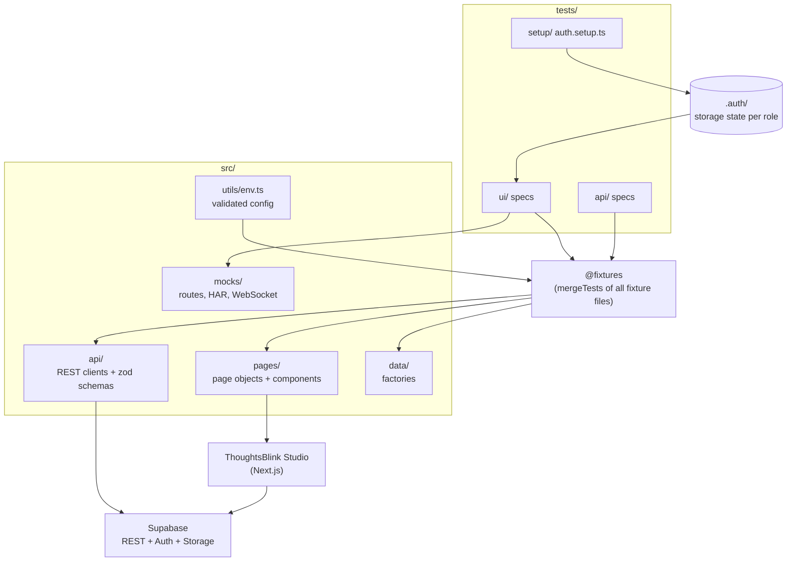

# ThoughtsBlink Playwright Framework

[](https://github.com/varshalearner/thoughtsblink-playwright-framework/actions/workflows/ci.yml)
[](https://github.com/varshalearner/thoughtsblink-playwright-framework/actions/workflows/nightly.yml)


[](LICENSE)

End-to-end, API, accessibility and visual test automation for
[ThoughtsBlink Studio](https://thoughtsblink.vercel.app), an online marketplace to buy, sell and
commission original art (Next.js + Supabase).

**139 tests in 29 files**, run on Chromium, Firefox, WebKit and two phones, plus a
browserless API project. The suite has found [8 bugs in the app](BUGS.md), including a
critical one: buyers could create orders marked as paid without paying.

## Contents

- [What it covers](#what-it-covers)
- [Architecture](#architecture)
- [Getting started](#getting-started)
- [Running tests](#running-tests)
- [Project structure](#project-structure)
- [Design decisions](#design-decisions)
- [Continuous integration](#continuous-integration)
- [Bugs found](#bugs-found)
- [What I'd add next](#what-id-add-next)

## What it covers

| Area            | How                                                                                                         |
| --------------- | ----------------------------------------------------------------------------------------------------------- |
| UI flows        | Page Object Model with components; every page-object call is a named report step (`@step` decorator)        |
| API             | Typed clients for Supabase REST and the app's own routes; zod schemas as contracts (`toMatchSchema`)        |
| Security        | Visitors, buyers and artists attempt forbidden writes; tests check the Postgres error code, not only status |
| Roles           | Buyer, artist and admin; signed-in state built once per run; several users in one test (`openAs`)           |
| Network control | `route.fulfill`, `route.fetch` edits, outage simulation, HAR replay, a fake WebSocket (Realtime) server     |
| Test data       | faker-built listings created through the API per test and always deleted afterwards                         |
| Accessibility   | axe scans for WCAG 2.1 A/AA; known violations tracked as bugs, any new one fails                            |
| Visual          | `toHaveScreenshot` with Linux baselines generated in the Playwright Docker image                            |
| Time and locale | `page.clock` for relative timestamps; time zone and locale pinned                                           |
| Mobile          | Pixel 7 and iPhone 15 projects running the smoke subset plus phone-only navigation tests                    |
| Reliability     | Every UI test fails on uncaught page errors; worker-scoped health check; stress script (repeat + shuffle)   |

## Architecture



Specs import a single `test` from `@fixtures`, which merges these fixture files:

| Fixture file          | Gives the test                                                                     |
| --------------------- | ---------------------------------------------------------------------------------- |
| `site-health.fixture` | Automatic, once per worker: fails fast with one clear message if the site is down  |
| `page-errors.fixture` | The built-in `page`, wrapped to fail the test on uncaught errors in the app        |
| `pages.fixture`       | A page object per page (`shopPage`, `artworkPage`, ...)                            |
| `roles.fixture`       | `openAs(role)`: another signed-in user in a separate browser context               |
| `api.fixture`         | `anonApi`, `buyerApi`, `artistApi`, `adminApi`, `appApi`                           |
| `data.fixture`        | `createListing()` with automatic cleanup, and a chat thread for each parallel slot |
| `a11y.fixture`        | `makeAxeBuilder()` limited to WCAG 2.1 A/AA                                        |

## Getting started

Requirements: Node.js 22.22.1 or later, and test accounts on the app (buyer, artist, and an admin).

```bash
git clone https://github.com/varshalearner/thoughtsblink-playwright-framework.git
cd thoughtsblink-playwright-framework
npm ci
npx playwright install --with-deps
cp .env.example .env   # then fill in the values
```

The configuration is validated with zod when the run starts. A missing or malformed value
stops the run with a message that names the variable, instead of failing later inside a test.

| Variable                            | Purpose                                                         |
| ----------------------------------- | --------------------------------------------------------------- |
| `TEST_ENV`                          | `prod` (default) or `local`; set it in the shell, not in a file |
| `BASE_URL`                          | Optional: point the run at another deployment (e.g. a preview)  |
| `SUPABASE_URL`, `SUPABASE_ANON_KEY` | Public Supabase values used by the API tests                    |
| `BUYER_*`, `ARTIST_*`, `ADMIN_*`    | Email and password for each role's test account                 |

## Running tests

| Command                   | What it runs                                                |
| ------------------------- | ----------------------------------------------------------- |
| `npm test`                | Everything, every project                                   |
| `npm run test:smoke`      | `@smoke`, the critical paths                                |
| `npm run test:regression` | `@regression`                                               |
| `npm run test:api`        | The browserless API project                                 |
| `npm run test:chromium`   | UI tests on desktop Chrome only                             |
| `npm run test:changed`    | Only tests affected by changes since `main`                 |
| `npm run test:stress`     | Every test three times in random order (proves isolation)   |
| `npm run test:local`      | Against a local copy of the app on `localhost:3000`         |
| `npm run test:ui`         | Playwright UI mode                                          |
| `npm run test:debug`      | Step through in the inspector                               |
| `npm run report`          | Open the last HTML report                                   |
| `npm run check`           | Lint, type-check and format check (also run before commits) |

Tags: `@smoke`, `@regression`, `@api`, `@a11y`, `@visual`, `@mobile`, `@har`. Every test must
have at least one (enforced by ESLint).

## Project structure

```text
.github/workflows/    ci.yml, nightly.yml, update-snapshots.yml
scripts/              scrub-har.mts: removes tokens and personal data from recorded HARs
src/
  api/                REST clients (listings, orders, profiles, chat, ...) and zod schemas
  data/               test data factories (faker) and in-memory files for upload tests
  fixtures/           fixture files, merged in index.ts and imported as @fixtures
  mocks/              route mocks, HAR replay, fake Realtime WebSocket, practice page
  pages/              page objects, with components/ for shared parts (header, dialogs)
  utils/              env.ts (validated config), auth-state.ts, the @step decorator
tests/
  api/                contract, permission and security tests, grouped by resource
  setup/              signs each role in once and saves its browser state
  ui/                 UI specs grouped by feature (shop, sell, chat, admin, a11y, visual, ...)
  hars/               recorded, scrubbed network traffic
playwright.config.ts  projects: api, setup, chromium, firefox, webkit, mobile-chrome, mobile-safari
BUGS.md               bugs found by the suite, each with a test that turns red when it is fixed
```

## Design decisions

| Decision                                                            | Why                                                                                                                        |
| ------------------------------------------------------------------- | -------------------------------------------------------------------------------------------------------------------------- |
| Fixtures instead of `beforeEach` / `afterEach`                      | A test names what it needs; setup and cleanup live in one place and run only for tests that ask for them                   |
| Override `page` for page-error checks, not an `auto` fixture        | An `auto` fixture would launch a browser for API tests too                                                                 |
| API tests in their own browserless project                          | Running them once per browser would triple the time and the logins against Supabase's rate limit                           |
| Sign in once per role per worker, lazily                            | Stays far below the auth rate limit; a broken admin account cannot fail tests that only need a buyer                       |
| Sessions signed out when the worker ends                            | A failed API call prints its bearer token into the report; once signed out, it can no longer change the account            |
| Test data created through the API, deleted in fixture teardown      | Faster and more reliable than building it through the UI; nothing is left behind, even when a test fails                   |
| Bugs kept as `test.fail()` tests with an `issue` annotation         | The suite stays green while the bug exists and tells us when it is fixed                                                   |
| Permission tests check the Postgres error code                      | A `403` alone cannot tell row-level security from an unrelated failure                                                     |
| Every mock checked by running the test once without it              | Proves the mock is what the test depends on                                                                                |
| Time zone and locale pinned in the config                           | The app picks currency and language from them, so results would differ by machine                                          |
| Local runs use `workers: '25%'`                                     | Measured: 8 workers starved the browser (6 failures in 153 runs); 4 workers had none in the same time                      |
| Tracing off in specs that type passwords                            | Traces store values typed with `fill()`                                                                                    |
| `--fail-on-flaky-tests` on pull requests, not nightly               | A test that only passes on retry should block a merge; the nightly run reports flakiness instead of hiding everything else |
| Reports as private CI artifacts, not public GitHub Pages            | A report from a failed API call can contain a token                                                                        |
| Exact dependency versions, Docker image matching `@playwright/test` | Browsers, screenshots and behaviour are the same on every machine                                                          |

## Continuous integration

| Workflow               | When                                  | What                                                                                                 |
| ---------------------- | ------------------------------------- | ---------------------------------------------------------------------------------------------------- |
| `ci.yml`               | Every pull request and push to `main` | Lint, types and format first; then `@smoke` on every project in the official Playwright Docker image |
| `nightly.yml`          | Every night, and on demand            | The full suite on 4 shards in parallel, merged into one HTML and one JUnit report                    |
| `update-snapshots.yml` | On demand                             | Generates Linux screenshot baselines in the same image, for a person to review and commit            |

Retries are 2 in CI and 0 locally. Traces are kept on the first retry; screenshots and videos
on failure. Secrets come from GitHub Actions secrets.

## Bugs found

| ID                         | Summary                                                        | Severity |
| -------------------------- | -------------------------------------------------------------- | -------- |
| [BUG-004](BUGS.md#bug-004) | Buyers can create orders marked as paid without paying         | Critical |
| [BUG-002](BUGS.md#bug-002) | Visitors can read every user's email and payout details        | High     |
| [BUG-003](BUGS.md#bug-003) | Sellers can verify themselves and lift their own suspension    | High     |
| [BUG-005](BUGS.md#bug-005) | Any user can put notifications with any link in anyone's inbox | Medium   |
| [BUG-007](BUGS.md#bug-007) | Primary buttons and links fail colour contrast (WCAG 1.4.3)    | Medium   |

[BUGS.md](BUGS.md) has all eight, each with steps to reproduce, the cause and a suggested fix.

## What I'd add next

- **A dedicated test environment.** Tests run against the live site with dedicated accounts and
  clean up after themselves. A separate Supabase project would allow destructive tests and seeded data.
- **Contract tests from the database schema.** Generate the zod schemas from Supabase types so a
  schema change breaks the build, not a test run.
- **Tests on preview deployments.** Run smoke tests against each Vercel preview before the app merges.
- **Performance budgets.** Lighthouse or Web Vitals checks on the key pages.
- **Notifications.** A custom reporter that posts the nightly result to chat.

## License

[MIT](LICENSE)
